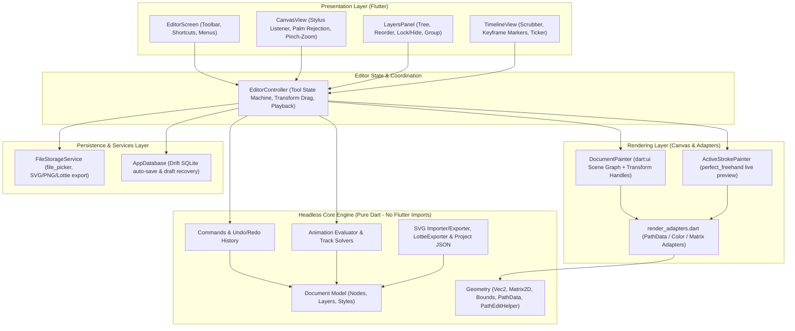

# SVG Builder

A professional, tablet-first vector graphics editor and animation suite built with **Flutter**.

SVG Builder pairs low-latency, pressure-sensitive stylus sketching (Apple Pencil, S-Pen, Surface Pen) with timeline-driven keyframe animation, direct bezier path node editing, local-first SQLite persistence, and multi-format exports (SVG 1.1, Bodymovin / Lottie JSON, high-res PNG, and native `.svgb`).

---

## Key Features

- **Stylus-First Input Pipeline**
  - **Dynamic Brushes:** Continuous pressure and tilt dynamics mapped directly to stroke width via `perfect_freehand`.
  - **Hardware Palm Rejection:** Automatically prioritizes active stylus pointers (`PointerDeviceKind.stylus` / `invertedStylus`), filtering out accidental finger/palm touch events while sketching.
  - **Zero-Latency Live Preview:** Active strokes are painted on a dedicated foreground canvas layer before commit.
  - **Raw Sensor Retention:** Raw stylus sensor samples (`x`, `y`, `pressure`, `tilt`, `orientation`, `timeMs`) are saved with each stroke node for post-draw re-styling and re-fitting.

- **Interactive Vector Canvas & Ergonomics**
  - **Direct Path Node Editing:** Sub-segment node editing mode to select and drag individual anchor points and cubic/quadratic bezier control handles with real-time curve reshaping.
  - **Transform Handles:** 4 corner scale handles and a top rotation handle with a dashed guide line for smooth bounding box transformations.
  - **Multi-Touch Viewport:** Two-finger pinch-to-zoom (0.1x to 10x) and pan navigation.
  - **Drawing Tools:** Freehand Pen, Rectangle, Ellipse, Select/Inspect, and Path Node Editor.
  - **Desktop Accelerators:** Full keyboard bindings (`Ctrl/Cmd+Z`, `Ctrl/Cmd+Y`, `Ctrl/Cmd+S`, `Delete`, `Ctrl/Cmd+G`, `V/P/R/O` tool keys, and 1px / 10px arrow nudging).

- **Layers & Hierarchy Management**
  - Collapsible side panel with hierarchical tree inspection.
  - Drag-and-drop layer reordering using `ReorderableListView`.
  - Visibility (`visible`) and edit lock (`locked`) toggles per node and layer.
  - Multi-element grouping into container `GroupNode`s.

- **Keyframe Animation Engine**
  - **Timeline Scrubber:** Bottom timeline widget with interactive drag-scrubbing, playback controls, and elapsed time readouts.
  - **Property Tracks:** Keyframing for position (`x`, `y`), rotation, scale (`scaleX`, `scaleY`), opacity, and colors (`fill`, `stroke`).
  - **CSS Easing Curves:** Precision cubic-bezier solver with standard presets (`linear`, `ease`, `ease-in`, `ease-out`, `ease-in-out`, `step`).
  - **Non-Destructive Evaluation:** Pure function frame evaluator (`evaluateAt(doc, t)`) generating live snapshots at any timestamp without mutating the base scene.

- **Local-First Persistence & File I/O**
  - **Background Auto-Save:** Embedded SQLite database powered by `drift` debouncing document edits (1.5s delay) to ensure zero data loss on app close or crash.
  - **Startup Draft Recovery:** Automatically restores previous workspaces seamlessly on launch.
  - **Multi-Format Export & Import:**
    - **SVG 1.1:** Clean, standards-compliant SVG import & export with viewBox normalization and styling.
    - **Lottie JSON:** Bodymovin 5.7.8 compliant export for web, Flutter (`package:lottie`), iOS, and Android.
    - **High-Res PNG:** 2x resolution raster bitmap export via `ui.PictureRecorder`.
    - **Native `.svgb`:** Versioned JSON project bundles preserving the full scene graph, animations, and raw stylus telemetry.

- **Pure Dart Headless Core (`lib/core/`)**
  - **Zero UI Dependencies:** The core engine operates completely decoupled from Flutter widgets and `dart:ui`. It can be run and tested headlessly, or utilized in CLI/backend server environments.
  - **Transactional Edit History:** Reversible Command pattern (`AddNodeCommand`, `RemoveNodeCommand`, `UpdateNodeCommand`, `MoveNodeCommand`, `SetTrackCommand`, `UpdatePathGeometryCommand`, `BatchCommand`) with smart gesture coalescing in `History`.

---

## Architecture Overview

SVG Builder is structured into cleanly decoupled architectural layers:



### Directory Structure

```text
lib/
├── core/                        # Pure Dart Headless Core (no Flutter imports)
│   ├── animation/               # Easing curves, property tracks, frame evaluator
│   ├── commands/                # Reversible commands & linear undo/redo History
│   ├── geometry/                # Vec2, Matrix2D, Bounds, Transform2D, PathData, PathEditHelper
│   ├── io/                      # SVG import/export, LottieExporter & ProjectFormat JSON
│   ├── model/                   # Document, GroupNode, ShapeNode, Color, Style, IdGenerator
│   └── util/                    # Compact number formatting & SVG parsers
├── render/                      # Canvas adapters & Painters
│   ├── document_painter.dart    # CustomPainter rendering scene graph, handles, and nodes
│   ├── render_adapters.dart     # Conversions from Core to dart:ui (Path, Matrix, Paint)
│   └── stroke_renderer.dart     # perfect_freehand vector outline generator & live painter
├── services/                    # Persistence & File I/O Services
│   ├── database/                # Drift SQLite database & debounced AutoSaveService
│   └── file_storage_service.dart# file_picker v13 integration, SVG/PNG/Lottie export
├── ui/                          # Flutter User Interface
│   ├── canvas_view.dart         # Interactive stylus/touch drawing canvas
│   ├── editor_controller.dart   # Central controller coordinating history, playback & tools
│   ├── editor_screen.dart       # Main workspace layout (toolbars, app bar, drawers)
│   ├── editor_shortcuts.dart    # Desktop keyboard shortcuts map (Shortcuts & Actions)
│   ├── layers_panel.dart        # Reorderable layer & object hierarchy side drawer
│   ├── timeline_view.dart       # Animation timeline, scrubber, and keyframing
│   └── transform_handles.dart   # Interactive bounding scale and rotation handle calculations
└── main.dart                    # Application entry point
```

---

## Keyboard Shortcuts Reference

| Shortcut | Action |
|---|---|
| `Ctrl/Cmd + Z` | Undo last action |
| `Ctrl/Cmd + Y` or `Ctrl/Cmd + Shift + Z` | Redo last action |
| `Ctrl/Cmd + S` | Save project file (`.svgb`) |
| `Delete` / `Backspace` | Delete selected element(s) |
| `Ctrl/Cmd + G` | Group selected elements |
| `V` | Switch to **Select / Move** tool |
| `P` | Switch to **Freehand Pen** tool |
| `R` | Switch to **Rectangle** tool |
| `O` | Switch to **Ellipse** tool |
| `Arrow Keys` | Nudge selected element by 1 px |
| `Shift + Arrow Keys` | Nudge selected element by 10 px |

---

## Getting Started

### Prerequisites

- [Flutter SDK](https://flutter.dev/docs/get-started/install) (3.24+ / 3.44+)
- Dart 3.5+

### Installation & Execution

1. **Clone the repository:**
   ```bash
   git clone https://github.com/your-username/svg_builder.git
   cd svg_builder
   ```

2. **Install dependencies:**
   ```bash
   flutter pub get
   ```

3. **Generate Drift SQLite database code:**
   ```bash
   dart run build_runner build
   ```

4. **Run the test suite:**
   ```bash
   flutter test
   ```

5. **Launch the application:**
   - **Desktop (Windows/macOS/Linux):**
     ```bash
     flutter run -d windows
     ```
   - **Tablet / Mobile (Android/iOS):**
     ```bash
     flutter run -d <device-id>
     ```
   - **Web:**
     ```bash
     flutter run -d chrome
     ```

---

## Testing & Quality Assurance

The codebase maintains strict quality standards and full test coverage across core math, serialization, node editing, and user interface rendering:

- **Core Engine Tests (`test/core/core_test.dart`):** Verifies 2D vector & matrix operations, SVG parse/export round-tripping, command undo/redo merging, and animation track easing.
- **Node Edit & Lottie Tests (`test/core/phase6_7_test.dart`):** Validates bezier sub-point hit-testing, anchor mutation commands, and Bodymovin JSON structure compliance.
- **Widget Integration Tests (`test/widget_test.dart`):** Ensures responsive layout and canvas mounting without render overflows.
- **Static Analysis:**
   ```bash
   flutter analyze
   ```

---

## Roadmap

- [x] **Phase 1:** Headless Core Engine (Geometry, Document Model, Commands, SVG I/O, Animation Evaluator).
- [x] **Phase 2:** Stylus & Canvas Integration (Pressure sensitivity via `perfect_freehand`, palm rejection, primitive tools).
- [x] **Phase 3:** Timeline Scrubber & Interactive Animation Controls (Playback ticker, diamond keyframe markers, track manipulation).
- [x] **Phase 4.1:** File Storage Services (`.svgb` project files, SVG export, 2x PNG rendering).
- [x] **Phase 4.2:** Local-First SQLite Persistence (`drift` background auto-save and launch draft recovery).
- [x] **Phase 5:** Desktop Ergonomics (Keyboard shortcut map, layer hierarchy panel, scale & rotate transform handles).
- [x] **Phase 6:** Direct Bezier Path Node Editing (Sub-segment anchor & control point selection and curve reshaping).
- [x] **Phase 7:** Bodymovin / Lottie Animation Export (JSON compilation for web, Flutter, and mobile).
- [ ] **Phase 8:** Real-Time Collaboration (CRDT synchronization).

---

## License

This project is licensed under the MIT License. See the [LICENSE](LICENSE) file for details.
