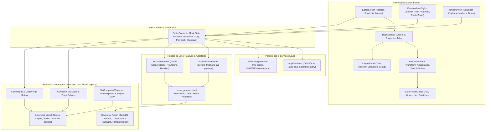

# SVG Builder

A professional, tablet-first vector graphics editor and animation suite built with **Flutter**, optimized for **Android Tablets (API 29+) with S Pen / active stylus**.

SVG Builder pairs low-latency, pressure-sensitive stylus sketching with timeline-driven keyframe animation, direct bezier path node editing, a full properties inspector, layer management, local-first SQLite persistence, and multi-format exports (SVG 1.1, Bodymovin / Lottie JSON, high-res PNG, and native `.svgb`).

---

## Key Features

- **Stylus-First & Tablet Ergonomics (S Pen & Active Stylus)**
  - **Pen-Only Mode:** Finger touches exclusively navigate, pan, and zoom the canvas while the S Pen or active stylus inking is reserved for drawing. Toggleable via the toolbar.
  - **Hardware Eraser & S Pen Button:** Physical inverted eraser end (`PointerDeviceKind.invertedStylus`) and S Pen side button (`kPrimaryStylusButton`, `kSecondaryStylusButton`) seamlessly activate the stroke eraser with unified undo history.
  - **Procreate-Style Gestures:** Two-finger tap for **Undo**; three-finger tap for **Redo**; midpoint focal pinch-to-zoom without drift.
  - **Stylus Hover Preview:** Hover cursor ring matching real brush size and stroke color.
  - **120Hz Isolated Drawing Pipeline:** Active stroke updates route through `activeStrokeNotifier`, bypassing full-tree widget rebuilds during live inking.
  - **RDP Curve Simplification:** Ramer-Douglas-Peucker decimation on pen-up reduces stroke vertex count by 60–80% without fidelity loss.

- **Interactive Vector Canvas & Core Editing**
  - **Unified Right Sidebar:** Tabbed dockable sidebar hosting **Layers** and **Properties** inspectors.
  - **Properties Inspector Panel:** Real-time property editing for selected nodes:
    - *Transform:* X, Y position, Width, Height, and Rotation scrubbers.
    - *Appearance:* Fill & Stroke pickers, Stroke Width, Opacity slider, and Corner Radius.
    - *Typography:* Text editing, Font Size, and Fill Color for `TextNode`.
    - *Arrangement:* One-tap Z-ordering actions (Bring Forward, Send Backward, Bring to Front, Send to Back).
    - *Canvas Settings:* Background color toggle and palette selector.
  - **HSV Color Picker Dialog:** Full tablet color picker with HSV saturation/value wheel, hue slider, alpha opacity, hex `#RRGGBB` input, preset swatches, and automatic extraction of all colors used across the current document.
  - **Direct Path Node Editing:** Sub-segment node editing mode to select and drag individual anchor points and cubic/quadratic bezier control handles with real-time curve reshaping.
  - **Transform Handles:** Corner scaling with opposite-handle pivot stability and center-anchored rotation.
  - **Drawing Tools:** Freehand Pen (P), Stroke Eraser (E), Rectangle (R), Ellipse (O), Text Label (T), Select/Move (V), and Path Node Editor.
  - **Clipboard & Arrangement:** Copy (Ctrl+C), Cut (Ctrl+X), Paste (Ctrl+V) with +20px offset and unique IDs, Duplicate (Ctrl+D), Delete, and Group/Ungroup.
  - **Selection Context Menu:** Long-press on any canvas selection to duplicate, delete, reorder z-index, or group/ungroup.

- **Layers & Hierarchy Management**
  - Collapsible side panel with hierarchical tree inspection.
  - **Active Layer Indicator:** Target layer badge (`ACT`) directing newly created shapes or strokes into the selected layer.
  - Drag-and-drop layer reordering using `ReorderableListView`.
  - Double-tap to rename layers and elements.
  - Visibility (`visible`) and edit lock (`locked`) toggles per node and layer.
  - Multi-element grouping and one-click ungrouping into parent container.

- **Keyframe Animation Engine**
  - **Multi-Track Timeline:** Individual property track breakdowns (Position X/Y, Rotation, Scale X/Y, Opacity, Fill, Stroke) plus summary lane.
  - **Keyframe Dragging & Frame Snapping:** Interactive keyframe repositioning along the time ruler with frame snapping (`12/24/30/60 FPS`) and coalesced undo history.
  - **Easing Curve Customization:** Interactive easing picker dialog with live 2D cubic-bezier curve editor, numeric coordinate controls, and presets (`linear`, `ease`, `ease-in`, `ease-out`, `ease-in-out`, `step`).
  - **Timeline Settings:** Configurable animation duration, FPS, loop playback, and snap toggle in a dedicated dialog.
  - **Playback & Navigation:** Time ruler with seconds and frame ticks, vertical playhead spanning lanes, jump to previous/next keyframe buttons, frame counter (`F: 15 / 180`), and collapsible layout (shrinks to 42px) to maximize drawing space.
  - **Auto-Keying:** Dragging transforms on canvas at `currentTime > 0` automatically records keyframes.
  - **Non-Destructive Evaluation:** Pure function frame evaluator (`evaluateAt(doc, t)`) generating live snapshots at any timestamp without mutating the base scene.

- **Tablet Layout, Projects & System Integration**
  - **Project Browser Grid (Home Screen):** Modern tablet dashboard featuring project cards with live aspect ratio thumbnails, element count badges, search filtering, "+ New Drawing", SVG/project import, rename, duplicate, and delete actions.
  - **Responsive Dual-Mode Layout:** Dynamic `LayoutBuilder` providing a docked right sidebar on wide landscape tablet screens ($\ge 800$px) and a smooth slide-over overlay drawer for narrow portrait or 50/50 split-screen windows ($< 800$px).
  - **Canvas Framing & Artboard:** Centered artboard framing with drop shadow, subtle boundary stroke, and background fill. Includes a floating zoom pill (zoom % readout, zoom in/out, fit-to-screen with viewport padding, and artboard clipping toggle).
  - **Onboarding Gestures Guide:** Interactive 3-step tablet onboarding guide illustrating S Pen inking dynamics, two-finger navigation, and Procreate gestures.
  - **Android Lifecycle Persistence & Safe Exit:** `WidgetsBindingObserver` automatically saves drafts immediately when the app is paused/inactive. `PopScope` intercepts back gestures to save immediately and return cleanly to `HomeScreen`.

- **Local-First Persistence & File I/O**
  - **Background Auto-Save:** Embedded SQLite database powered by `drift` debouncing document edits (1.5s delay) avoiding playback timer churn, with immediate-save on lifecycle transitions.
  - **Startup Draft Recovery:** Automatically restores previous workspaces seamlessly on launch with collision-free ID generation.
  - **Multi-Format Export & Import:**
    - **SVG 1.1:** Clean, standards-compliant SVG import & export with viewBox normalization, `dominant-baseline="alphabetic"` text alignment, and full style preservation.
    - **Lottie JSON:** Bodymovin 5.7.8 compliant export with cubic bezier easing handles (`o`, `i`), step hold frames, combined ancestral group transforms, and animated fill & stroke color tracks.
    - **High-Res PNG:** Configurable resolution scale ($1\times$, $2\times$, $4\times$) with optional transparent background support.
    - **Native Android Share Sheet:** Share SVG, PNG, or Lottie animations directly into Slack, Discord, Drive, Gmail, or nearby devices via `share_plus`.
    - **Native `.svgb`:** Versioned JSON project bundles preserving the full scene graph, animations, and raw stylus telemetry.
  - **Global Crash Protection:** Unhandled exception handlers (`FlutterError.onError` and `PlatformDispatcher.instance.onError`) intercept errors to prevent data corruption.

- **Pure Dart Headless Core (`lib/core/`)**
  - **Zero UI Dependencies:** The core engine operates completely decoupled from Flutter widgets and `dart:ui`. It can be run and tested headlessly, or utilized in CLI/backend server environments.
  - **Transactional Edit History:** Reversible Command pattern (`AddNodeCommand`, `RemoveNodeCommand`, `UpdateNodeCommand`, `MoveNodeCommand`, `SetTrackCommand`, `UpdatePathGeometryCommand`, `BatchCommand`) with smart gesture coalescing in `History`.

---

## Architecture Overview



### Directory Structure

```text
lib/
├── config/                      # Feature flags (enableCollaboration = false)
├── core/                        # Pure Dart Headless Core (no Flutter imports)
│   ├── animation/               # Easing curves, property tracks, frame evaluator
│   ├── collaboration/           # CRDT sync engine, peer presence data models
│   ├── commands/                # Reversible commands & linear undo/redo History
│   ├── geometry/                # Vec2, Matrix2D, Bounds, Transform2D, PathData, PathEditHelper
│   ├── io/                      # SVG import/export, LottieExporter & ProjectFormat JSON
│   ├── model/                   # Document, GroupNode, ShapeNode, Color, Style, IdGenerator
│   └── util/                    # Compact number formatting & SVG parsers
├── render/                      # Canvas adapters & Painters
│   ├── document_painter.dart    # CustomPainter rendering scene graph, handles, and nodes
│   ├── render_adapters.dart     # Conversions from Core to dart:ui (Path, Matrix, Paint)
│   └── stroke_renderer.dart     # perfect_freehand vector outline generator & live painter
├── services/                    # Persistence & File I/O Services
│   ├── database/                # Drift SQLite database & debounced AutoSaveService
│   ├── collaboration/           # WebSocket collaboration client (gated)
│   └── file_storage_service.dart# file_picker v13 integration, safe URI export
├── ui/                          # Flutter User Interface
│   ├── canvas_view.dart         # Interactive stylus/touch drawing canvas
│   ├── color_picker_dialog.dart # HSV + Hex color picker modal
│   ├── easing_picker_dialog.dart# Cubic bezier & preset easing curve inspector
│   ├── editor_controller.dart   # Central controller coordinating history, playback & tools
│   ├── editor_screen.dart       # Main workspace layout (toolbars, app bar, sidebar)
│   ├── editor_shortcuts.dart    # Keyboard shortcuts map (Shortcuts & Actions)
│   ├── home_screen.dart         # Project browser dashboard grid & import hub
│   ├── layers_panel.dart        # Reorderable layer & object hierarchy panel
│   ├── onboarding_guide_dialog.dart # Tablet stylus & gesture guide
│   ├── properties_panel.dart    # Transform, style, text, and z-ordering inspector
│   ├── right_sidebar.dart       # Tabbed container for Layers and Properties
│   ├── timeline_settings_dialog.dart # Duration, FPS, loop, and snap settings modal
│   ├── timeline_view.dart       # Multi-track timeline, scrubber, and keyframing
│   └── transform_handles.dart   # Interactive bounding scale and rotation handle calculations
└── main.dart                    # Application entry point with global crash protection
```

---

## Keyboard Shortcuts Reference

| Shortcut | Action |
|---|---|
| `Ctrl/Cmd + Z` | Undo last action |
| `Ctrl/Cmd + Y` or `Ctrl/Cmd + Shift + Z` | Redo last action |
| `Ctrl/Cmd + S` | Save project file (`.svgb`) |
| `Ctrl/Cmd + C` | Copy selected elements |
| `Ctrl/Cmd + X` | Cut selected elements |
| `Ctrl/Cmd + V` | Paste elements (+20px offset, unique IDs) |
| `Ctrl/Cmd + D` | Duplicate selected elements |
| `Delete` / `Backspace` | Delete selected element(s) |
| `Ctrl/Cmd + G` | Group selected elements |
| `V` | Switch to **Select / Move** tool |
| `P` | Switch to **Freehand Pen** tool |
| `E` | Switch to **Stroke Eraser** tool |
| `R` | Switch to **Rectangle** tool |
| `O` | Switch to **Ellipse** tool |
| `T` | Switch to **Text Label** tool |
| `Arrow Keys` | Nudge selected element by 1 px |
| `Shift + Arrow Keys` | Nudge selected element by 10 px |

---

## Testing & Quality Assurance

The codebase maintains strict quality standards and full automated test coverage (**78 passing tests** across core math, serialization, node editing, tablet stylus dynamics, multi-track animation, and UI layout):

- **Core Engine Tests (`test/core/core_test.dart`):** Verifies 2D vector & matrix operations, SVG parse/export round-tripping, command undo/redo merging, and animation track easing.
- **Sprint S1 Tests (`test/core/sprint_s1_test.dart`):** Validates local-space hit testing with matrix inversion, ID collision prevention on restore, center-pivot rotation, opposite-corner scaling, and auto-keying.
- **Sprint S2 Tests (`test/core/sprint_s2_test.dart`):** Validates stroke eraser detection, high-frequency stroke notifier isolation (`activeStrokeNotifier`), RDP curve decimation, and pen-only mode.
- **Sprint S3 Tests (`test/core/sprint_s3_test.dart`):** Validates `TextNode` insertion & hit testing, clipboard operations (copy/cut/paste/duplicate), z-ordering, ungrouping, active layer targeting, and property editing.
- **Sprint S4 Tests (`test/core/sprint_s4_test.dart`):** Validates multi-property keyframing & evaluation, keyframe deletion with undo/redo, frame snapping, gesture-merged keyframe dragging, cubic bezier/step easing curve customization, timeline duration/FPS settings, and keyframe jumping.
- **Sprint S5 Tests (`test/core/sprint_s5_test.dart`):** Validates SQLite project CRUD, duplicate project isolation, immediate auto-saving without debounce delay, artboard fit-to-screen viewport calculation, and artboard clipping.
- **Sprint S6 Tests (`test/core/sprint_s6_test.dart`):** Validates Lottie cubic bezier handles (`o`, `i`), step hold frames, combined parent group transforms, animated fill & stroke color tracks, SVG alphabetic text baseline alignment, and multi-scale ($1\times, 2\times, 4\times$) & transparent PNG rendering.
- **Phase 6 & 7 Tests (`test/core/phase6_7_test.dart`):** Validates bezier sub-point hit testing, anchor mutation commands, and Bodymovin Lottie JSON compliance.
- **Phase 8 CRDT Tests (`test/core/phase8_crdt_test.dart`):** Validates CRDT document reconciler and presence models.
- **Widget Tests (`test/widget_test.dart`):** Verifies responsive layout and canvas mounting without render overflows.

Run the complete test suite:
```bash
flutter test
```

Run static analysis:
```bash
dart analyze
```

---

## Roadmap

- [x] **Sprint S0: Housekeeping & Android Setup** (Android API 29+ minSdk, hardware orientation/touch flags, feature flag gating).
- [x] **Sprint S1: Critical Correctness Fixes** (Local-space hit testing, non-colliding IDs, opposite-pivot scaling, center rotation, auto-keying, safe Android file export).
- [x] **Sprint S2: Stylus Input & Performance** (Pen-only mode, S Pen eraser/side-button support, Procreate-style gestures, hover preview, 120Hz stroke isolation, RDP decimation).
- [x] **Sprint S3: Core Editing UX** (Properties panel, HSV color picker dialog, tabbed right sidebar, text tool, stroke eraser tool, clipboard actions, z-ordering, layer management).
- [x] **Sprint S4: Animation Authoring** (Per-property timeline tracks, keyframe dragging & frame snapping, cubic bezier easing curve picker, timeline settings, collapsible timeline).
- [x] **Sprint S5: Tablet Layout & Projects** (Project grid browser, responsive split-screen layouts, canvas artboard framing, Android lifecycle persistence).
- [x] **Sprint S6: Export Quality & Release Prep** (Lottie easing handles & combined group transforms, SVG alphabetic baseline, multi-resolution PNG with transparency, Android share sheet, global crash protection).

---

## License

This project is licensed under the MIT License. See the [LICENSE](LICENSE) file for details.
