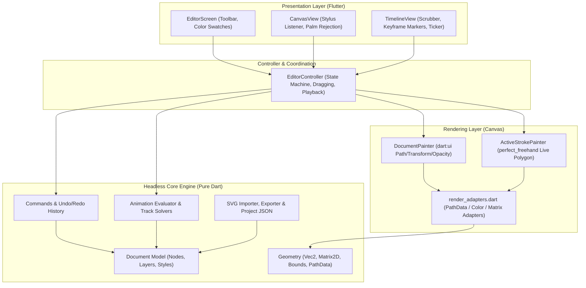

# SVG Builder

A tablet-first, cross-platform vector drawing and animation suite built with **Flutter**.

SVG Builder bridges fluid, pressure-sensitive stylus sketching (Apple Pencil, S-Pen, Surface Pen) with timeline-driven keyframe animation and clean, standards-compliant SVG/JSON export.

---

## Key Features

- **Stylus-First Input Pipeline**
  - Continuous pressure sensitivity and tilt dynamics mapped directly to stroke width.
  - Built-in palm rejection separating active stylus pointers from accidental touch contacts.
  - Zero-latency live stroke preview rendered via `perfect_freehand`.
- **Pure Dart Core Engine (`lib/core/`)**
  - **Zero UI dependencies:** Designed to be decoupled from Flutter's widget tree so geometry, math, document state, and serialization can be headlessly tested or run on CLIs/backends.
  - Custom 2D affine matrix math (`Matrix2D`, `Transform2D`, `Vec2`, `Bounds`).
  - Robust SVG path representation with cubic/quad/arc conversions, tight curve extrema bounds, and polygon/stroke hit-testing.
- **Keyframe Animation Engine**
  - Timeline-based property tracks (`x`, `y`, `rotation`, `scale`, `opacity`, `fill`, `stroke`, `strokeWidth`).
  - CSS-compatible cubic-bezier easing curves (`linear`, `ease`, `ease-in`, `ease-out`, `ease-in-out`, `step`).
  - Pure function frame evaluator (`evaluateAt(doc, t)`) providing non-destructive animation preview and export.
- **Standards-Compliant I/O**
  - **SVG 1.1 Export:** Generates clean, standard SVG documents with layers, styling, path data, transforms, and time-frame snapshots.
  - **SVG Import:** Parses external SVG paths, polygons, circles, rects, text, and transform attributes into editable node graphs.
  - **Project Serialization (`.svgb`):** Versioned JSON bundle format capturing the full document tree, raw stylus sensor samples, and animation timelines.
- **Transactional Edit History**
  - Full Undo / Redo command architecture (`Command`, `History`).
  - Smart gesture coalescing: continuous freehand drawing and transform drags merge into a single undo step upon pointer release.

---

## Architecture Overview

SVG Builder is structured into cleanly decoupled layers:



### Directory Structure

```text
lib/
├── core/                        # Pure Dart Headless Core (no Flutter imports)
│   ├── animation/               # Easing curves, property tracks, frame evaluator
│   ├── commands/                # Reversible commands & linear undo/redo History
│   ├── geometry/                # Vec2, Matrix2D, Bounds, Transform2D, PathData
│   ├── io/                      # SVG import/export & JSON project bundle
│   ├── model/                   # Document, GroupNode, ShapeNode, Color, Style
│   └── util/                    # Compact number formatting & SVG parsers
├── render/                      # Canvas adapters & Painters
│   ├── document_painter.dart    # CustomPainter rendering the document scene graph
│   ├── render_adapters.dart     # Conversions from Core to dart:ui (Path, Matrix, Paint)
│   └── stroke_renderer.dart     # perfect_freehand vector outline generator
├── ui/                          # Flutter User Interface
│   ├── canvas_view.dart         # Interactive stylus/touch drawing canvas
│   ├── editor_controller.dart   # Bridge between History, Tools, Playback, and UI
│   ├── editor_screen.dart       # Main tablet/desktop workspace layout
│   └── timeline_view.dart       # Animation timeline, scrubber, and keyframing
└── main.dart                    # Application entry point
```

---

## Getting Started

### Prerequisites

- [Flutter SDK](https://flutter.dev/docs/get-started/install) (3.24+ / 3.44+)
- Dart 3.5+

### Installation & Execution

1. **Clone the repository:**
   ```bash
   git clone https://github.com/your-username/svg_builder.git
   cd svg_builder
   ```

2. **Install dependencies:**
   ```bash
   flutter pub get
   ```

3. **Run the test suite:**
   ```bash
   flutter test
   ```

4. **Launch the application:**
   - **Desktop (Windows/macOS/Linux):**
     ```bash
     flutter run -d windows
     ```
   - **Tablet / Mobile (Android/iOS):**
     ```bash
     flutter run -d <device-id>
     ```
   - **Web:**
     ```bash
     flutter run -d chrome
     ```

---

## Testing & Quality Assurance

The project enforces strict code quality and comprehensive test coverage across both the headless core and widget interfaces:

- **Unit Tests:** `test/core/core_test.dart` verifies geometric formulas, matrix affine transforms, SVG round-tripping, command undo/redo merging, and animation keyframe interpolation.
- **Widget Tests:** `test/widget_test.dart` validates canvas rendering and user interface integration.
- **Static Analysis:**
  ```bash
  flutter analyze
  ```

---

## Roadmap

- [x] **Phase 1:** Headless Core Engine (Geometry, Document Model, Commands, SVG I/O, Animation Evaluator).
- [x] **Phase 2:** Stylus & Canvas Integration (Pressure sensitivity via `perfect_freehand`, palm rejection, shape creation, selections).
- [x] **Phase 3:** Timeline Scrubber & Interactive Animation Controls (Playback ticker, diamond keyframe markers, property track manipulation).
- [ ] **Phase 4:** Persistence & Local-First Database (`drift` SQLite storage, auto-save snapshots, file system open/save).
- [ ] **Phase 5:** Desktop Ergonomics (Keyboard shortcut map, menu bar integration, multi-selection bounding box transforms).
- [ ] **Phase 6:** Advanced SVG Features & Lottie Export (Gradients, clipping masks, Lottie JSON bundle compilation).
- [ ] **Phase 7:** Real-Time Collaboration (CRDT synchronization).

---

## License

This project is licensed under the MIT License. See the [LICENSE](LICENSE) file for details.
