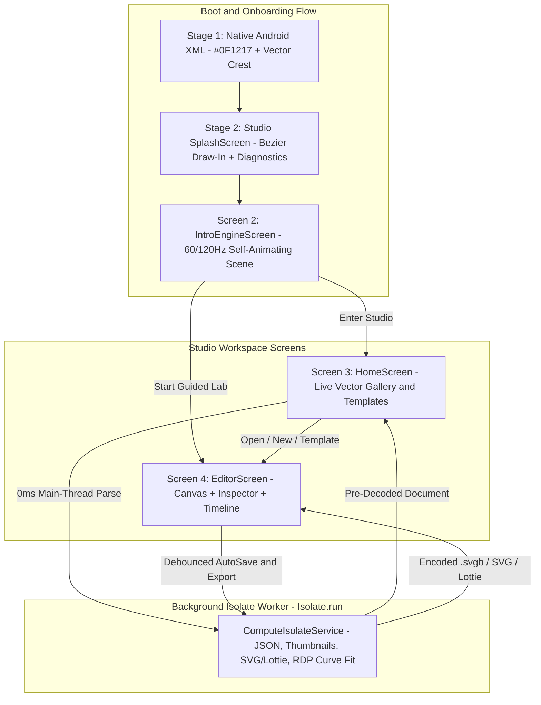

# SVG Builder (Pro Studio) — UI/UX Design System & Screen Requirements (`design.md`)

**Target Hardware & Runtime Baseline:**
- **Primary Form Factor:** High-Resolution Android Tablets with Active Stylus / S Pen (`2560 × 1600` WQXGA, e.g., Lenovo Tab `TB336FU`, Samsung Galaxy Tab S-series, 120Hz Impeller Vulkan pipeline, Android API 29+).
- **Secondary Form Factors:** Desktop (Windows / macOS / Linux) with keyboard shortcuts and mouse wheel zoom, plus adaptive narrow/split-screen tablet layouts (`< 800dp` width).
- **Theme Implementation:** [`lib/ui/theme/studio_theme.dart`](file:///d:/Flutter%20Projects/Personal/svg_builder/lib/ui/theme/studio_theme.dart)

---

## 1. Design Philosophy: Solid Matte Pro Studio

SVG Builder uses a **Solid Matte Pro Studio** aesthetic engineered specifically for creative vector illustration and keyframe motion design:

1. **Zero Glassmorphism / Zero Translucent Blurs:**
   - All panels, toolbars, floating HUD pills, and modals use **100% opaque solid matte surfaces** with crisp `1.0px–1.5px` structural borders.
   - Eliminating `BackdropFilter` blurs prevents GPU overdraw on high-DPI (`2560 × 1600`) displays, guarantees `60Hz–120Hz` frame pacing during live animation playback and stylus inking, and keeps artwork colors uncontaminated behind UI chrome.
2. **Strict 3-Pillar Color Architecture (2 Complementary + 1 Shining Offset):**
   - **Complementary Pillar 1 — Deep Slate Obsidian (Structural Foundation):** Recedes visually so the vector artboard commands maximum contrast.
   - **Complementary Pillar 2 — Cool Teal-Cyan (Interactive Harmony):** Indicates active selection bounds, vector path skeletons, active viewports, hover states, and structural toggles.
   - **Shining Offset Pillar — Electric Amber-Gold (Focal & Motion Accent):** Reserved exclusively for high-priority focal elements that must shine separately against the slate-and-cyan base—specifically **animation keyframes, the timeline playhead needle, active tool rim borders, interactive tutorial actions, and primary CTAs**.
3. **Screen-Space Constant Geometry:**
   - Canvas overlays (selection handles, rotation stems, smart alignment guides, and dimension badges) are decoupled from document zoom via [`SelectionOverlayPainter`](file:///d:/Flutter%20Projects/Personal/svg_builder/lib/render/selection_overlay_painter.dart), remaining a crisp `10 × 10 dp` whether zoomed out to `25%` or zoomed in to `800%`.

---

## 2. Color System & Semantic Tokens (`StudioTheme`)

| Token Name | Hex Code | Role & Usage |
| :--- | :--- | :--- |
| **Complementary 1: Deep Slate Obsidian** | | **Structural Foundation** |
| `StudioTheme.obsidianVoid` | `#0F1217` | App scaffold background, infinite canvas void outside artboard, deep timeline track wells |
| `StudioTheme.obsidianSurface` | `#161B22` | Primary app bars, left tool dock, right sidebar shell, timeline header bar |
| `StudioTheme.obsidianElevated` | `#1E2530` | Elevated cards, dialog bodies, floating HUD pills, numeric input fields |
| `StudioTheme.obsidianCard` | `#232B38` | Interactive project cards, sample template tiles, layer row active containers |
| `StudioTheme.obsidianBorder` | `#2A3442` | Crisp `1px` panel dividers, input borders, inactive card outlines |
| `StudioTheme.obsidianBorderBright` | `#384556` | Emphasized structural borders, swatch rings, table headers |
| **Complementary 2: Cool Teal-Cyan** | | **Interactive Harmony & Vector Geometry** |
| `StudioTheme.accentCyan` | `#06B6D4` | Primary interactive controls, selection bounding boxes, active layer badges, primary buttons |
| `StudioTheme.accentCyanBright` | `#22D3EE` | High-visibility vector path overlays, Bezier handle lines, active icon highlights, status badges |
| `StudioTheme.accentCyanSurface` | `#102E37` | Solid dark-teal fill behind active tool tiles, selected layer rows, and telemetry pills |
| **Shining Offset: Electric Amber-Gold** | | **Motion, Keyframes & Primary Focal Points** |
| `StudioTheme.accentAmber` | `#F59E0B` | Active tool rim border (`1.5px`), timeline playhead needle, keyframe diamonds, `+ POSE` CTA |
| `StudioTheme.accentAmberBright` | `#FBBF24` | Highlighted keyframe diamonds, scrubbable value readouts, tutorial coach accents |
| `StudioTheme.accentAmberSurface` | `#33240B` | Solid dark-amber surface fill for tutorial badges, keyframe buttons, and amber banners |
| **Typography & Semantic Status** | | **Readability & Feedback** |
| `StudioTheme.textPrimary` | `#F1F5F9` | Primary headings, active labels, numerical readouts |
| `StudioTheme.textSecondary` | `#94A3B8` | Secondary descriptions, inactive icon labels, property titles |
| `StudioTheme.textMuted` | `#64748B` | Disabled controls, ruler tick labels, subtle hints |
| `StudioTheme.successEmerald` | `#10B981` | Auto-save `"SAVED"` indicator, tutorial step completion, onion skin "next frame" tint |
| `StudioTheme.dangerCrimson` | `#EF4444` | Delete actions, destructive confirmation buttons, onion skin "previous frame" tint |

---

## 3. Typography, Iconography & Spatial Grid

- **UI Sans-Serif (Default):** Clean geometric system sans-serif for navigation, dialog headers, layer names, and tutorial instructions.
  - *Section Headers:* `11sp–13sp`, `FontWeight.w800–w900`, uppercase letter-spacing `0.8–1.2`.
  - *Body / Inspector Labels:* `12sp–13sp`, `FontWeight.w600`.
- **Technical Monospace (`fontFamily: 'monospace'`):** Mandatory for all changing numeric telemetry so digits never jitter horizontally during 60/120Hz scrubbing:
  - Coordinates (`X`, `Y`, `W`, `H`, `ROT`, `SX`, `SY`), zoom percentages (`100%`), frame counters (`F18 / 180`), timecodes (`0.60s`), brush sizes (`12px`), and hex color codes (`#06B6D4`).
- **Spatial & Touch Target Grid:**
  - **Base Grid Unit:** `4dp` / `8dp` increments.
  - **Border Radii:** `6dp` for compact inputs and badges, `8dp` for tool buttons and HUD pills, `10dp–12dp` for cards and modal dialogs.
  - **Tablet Stylus & Touch Targets:** Minimum `44 × 44 dp` hit area for primary toolbar actions; `58 × 46 dp` for left dock tool buttons.

---

## 4. Architecture & UI Data-Flow Diagram



---

## 5. Screen-by-Screen Functional & UI Requirements

### Screen 1: Two-Stage Launch & Animated Studio Splash Screen
- **Implementation:**
  - **Stage 1 (Native OS Cold Start):** [`android/app/src/main/res/drawable/launch_background.xml`](file:///d:/Flutter%20Projects/Personal/svg_builder/android/app/src/main/res/drawable/launch_background.xml) & [`splash_vector_logo.xml`](file:///d:/Flutter%20Projects/Personal/svg_builder/android/app/src/main/res/drawable/splash_vector_logo.xml)
  - **Stage 2 (Flutter Animated Boot):** [`lib/ui/splash_screen.dart`](file:///d:/Flutter%20Projects/Personal/svg_builder/lib/ui/splash_screen.dart)
- **Purpose:** Eliminate the jarring white Android cold-start flash and smoothly transition into an animated vector crest while initializing studio subsystems.
- **Visual & Layout Requirements:**
  - Full-bleed `obsidianVoid` (`#0F1217`) background with a centered `116 × 116 dp` rounded vector crest container (`obsidianSurface` `#161B22` with `accentCyan` border).
  - Custom `CustomPainter` (`_SplashVectorCrestPainter`) that progressively draws a cyan cubic Bezier wave, extends amber tangent control handles (`#F59E0B`), and pops in anchor squares and keyframe diamonds over `1850ms`.
  - Monospace boot status pill (`INITIALIZING VECTOR ISOLATE ENGINE...` → `MOUNTING 60/120HZ TIMELINE EVALUATOR...` → `STUDIO READY`) paired with a dual-tone (`accentCyan` + `accentAmberBright`) segmented progress bar.
- **Functional Requirements:**
  - Automatically navigates via a `350ms` `FadeTransition` to `IntroEngineScreen` upon completion.
  - Exposes a top-right **`SKIP →`** button (`accentCyanBright`) allowing instant bypass at any point during boot.

---

### Screen 2: Native Vector Intro Engine (`IntroEngineScreen`)
- **Implementation:** [`lib/ui/intro_engine_screen.dart`](file:///d:/Flutter%20Projects/Personal/svg_builder/lib/ui/intro_engine_screen.dart) + [`SampleProjectsCatalog.buildIntroLogoDocument()`](file:///d:/Flutter%20Projects/Personal/svg_builder/lib/core/io/sample_projects_catalog.dart)
- **Purpose:** Showcase the application's actual vector rendering and keyframe animation engine in real time (`60/120Hz`) rather than playing a pre-rendered video file.
- **Visual & Layout Requirements:**
  - **Two-Tier Brand & Telemetry Header Bar:**
    - Row 1: `SVG Builder PRO` emblem + `Skip to Studio →` quick link.
    - Row 2: `● LIVE VECTOR INTRO ENGINE` badge (`accentCyanSurface`), real-time evaluated timecode and frame counter (`T: 1.63s • FRAME 117/180 • 120 FPS`) in amber monospace, and emerald `● ISOLATE OK` status indicator.
  - **Adaptive Tablet Split-View (Landscape `>= 820dp`) / Stacked Scroll View (Portrait):**
    - **Left Stage (Flex 6):** Live `CustomPaint` canvas rendering `evaluateAt(_introDocument, _currentTime)` via `DocumentPainter` inside a dark slate viewport frame with 3 floating hardware telemetry pills (`CANVAS: 1080×1080 • STYLUS CALIBRATED`, `S-PEN 4096 LVLS`, `● RDP Tol: 0.12px`) and a bottom-docked **Interactive Timeline Scrubber** (Square amber Play/Pause button + custom Amber/Cyan `Slider` + `LIVE ENGINE 60/120HZ` badge).
    - **Right Pitch & Action Card (Flex 5):** Solid matte column detailing the title (`Vector Design & Keyframe Motion Studio`), 3 badge-tagged feature cards (**Stylus-First Vector Engine** `RDP FIT`, **Keyframe Timeline & Auto-Key** `120 HZ`, **Multi-Format Studio Export** `LOTTIE`), and two full-width action buttons:
      1. **Primary Shining Amber CTA (`✨ Start Guided Animation Lab`):** Pre-loads the starter scene in a background Isolate and launches `EditorScreen` with the 6-step interactive coach active.
      2. **Secondary Cyan Outline CTA (`Enter Studio Workspace`):** Transitions directly to `HomeScreen`.
  - **Bottom Studio Mode Switcher Bar (`54dp` height):** 4 quick-access studio tabs (`Projects`, `Studio`, `Engine`, `Diagnostics`).

---

### Screen 3: Home Screen — Project Hub & Motion Showcase (`HomeScreen`)
- **Implementation:** [`lib/ui/home_screen.dart`](file:///d:/Flutter%20Projects/Personal/svg_builder/lib/ui/home_screen.dart)
- **Purpose:** Central dashboard for managing local SQLite projects, launching artboard presets, exploring pre-built animated templates, and entering the Guided Animation Lab.
- **Visual & Layout Requirements:**
  - **Top App Bar (`obsidianSurface`):**
    - Brand emblem + `SVG Builder` title + `PRO STUDIO` amber badge.
    - Quick-launch **`Replay Intro`** button (`Icons.play_circle_outline`, `accentCyanBright`) and **`Animation Lab`** pill button (`accentAmberSurface` with `accentAmber` border).
    - Project search filter input (`220dp` width, `obsidianVoid` fill), **`Import SVG / .svgb`** button, and primary **`+ New Artboard`** button (`accentAmber` fill with dark text).
  - **Guided Animation Lab & Sample Showcase Strip:**
    - Horizontal scroll strip at the top of the workspace featuring:
      1. **Hero Interactive Tutorial Card (`300dp` width):** Highlighted with an `accentAmber` border (`1.5px`), `INTERACTIVE 6-STEP COACH` badge, description, and 1-tap launch into the guided tutorial.
      2. **3 Pre-Built Animated Sample Cards (`255dp` width each):** *Bouncing Crest Badge*, *Solar Orbit System*, and *Kinetic Neon Pulse*. Each card renders a **live vector miniature preview** (`DocumentPainter` at `t = 0.6s`) alongside duration/FPS metadata (`3.0s • 60 FPS`) and an `OPEN SAMPLE →` prompt.
  - **Responsive Saved Projects Grid (`SliverGridDelegateWithMaxCrossAxisExtent`):**
    - Max card width `280dp`, aspect ratio `1.08`, `16dp` grid spacing.
    - **Live Vector Thumbnail Preview:** Renders the actual vector `Document` decoded in a background Isolate via `ComputeIsolateService.decodeProjectSummariesAsync` inside a dark checkered/framed preview box.
    - **Metadata Footer:** Displays project title, relative timestamp (`Just now`, `5m ago`), artboard dimension badge (`1024×768`), element count badge (`14 els`), and context menu (`Rename`, `Duplicate`, `Delete`).
- **Functional Requirements:**
  - Opening any project passes its pre-decoded `Document` directly into `EditorScreen(initialDocument: doc)` so route transitions incur **$0\text{ms}$ main-thread JSON parsing**.

---

### Screen 4: Core Studio Editor Workspace (`EditorScreen`)
- **Implementation:** [`lib/ui/editor_screen.dart`](file:///d:/Flutter%20Projects/Personal/svg_builder/lib/ui/editor_screen.dart)
- **Purpose:** Primary production environment integrating the infinite vector canvas, stylus tool dock, floating contextual HUDs, tabbed layers/properties inspector, interactive tutorial coach, and keyframe timeline.

```
+--------------------------------------------------------------------------------------------------+
| [<-] [Project Title] [1024x768] [SAVED]   | Undo Redo | Group Ungroup | Grid Clip | Guide | Export |
+--------+--------------------------------------------------------------------+--------------------+
|        |  [Interactive 6-Step Tutorial Coach Banner (When Active)]          | [LAYERS] [INSPECT] |
| SELECT |                                                                    |--------------------|
| NODES  |                                                                    | + Layer  Dup  Del  |
| S-PEN  |                                                                    |--------------------|
| ERASER |                     INFINITE VECTOR CANVAS                         | v Layer 1      [o] |
| RECT   |                (DocumentPainter + Screen-Space                     |   # Hero Cube  [o] |
| OVAL   |                    SelectionOverlayPainter)                        |   O Orbit Ring [o] |
| TEXT   |                                                                    |                    |
| ------ |                                                                    |                    |
| [Pen]  |         +-----------------------------------------------+          |                    |
| (12px) |         | [Floating Contextual Selection Action Pill]   |          |                    |
| ------ |         +-----------------------------------------------+          |                    |
| (o)(o) |                                          [100% | FIT | 1:1 | + -]  |                    |
+--------+--------------------------------------------------------------------+--------------------+
| [|<] [Play/Pause] [>|] [Loop] [0.60s | F18] [AUTO-KEY] [+POSE] [ONION]      | [3.0s | 30 FPS] [-]|
|--------------------------------------------------------------------------------------------------|
| LAYER / TRACKS     | 0.0s        0.5s        1.0s        1.5s        2.0s        2.5s       3.0s |
| Hero Cube          |   ◆-----------------------◆-----------------------◆                         |
|   translateX [+]   |   ◇                       ◇                       ◇                         |
|   rotation   [+]   |   ◇                                               ◇                         |
+--------------------------------------------------------------------------------------------------+
```

#### 4.1 Top Studio Command Bar (`AppBar`)
- **Left Cluster:**
  - Back button (`Icons.arrow_back`) that triggers immediate lifecycle draft persistence (`_autoSaveService.saveImmediately`) before popping.
  - Editable Document Title chip + Artboard Resolution badge (`1024×768` in cyan monospace) — tapping either opens the **Canvas & Artboard Settings Dialog**.
  - **Live Auto-Save Status Pill (`ValueListenableBuilder<AutoSaveStatus>`):** Dynamically transitions between `SAVING...` (amber spinner), `SAVED` (emerald dot + border), and `SAVE ERR` (crimson) without rebuilding the editor.
- **Center-Right Action Clusters:**
  - **History Cluster:** `Undo (Ctrl+Z)` and `Redo (Ctrl+Y)` with reactive enabled/disabled states.
  - **Hierarchy & Boolean Path Ops Cluster:** `Group (Ctrl+G)`, `Ungroup (Ctrl+Shift+G)`, and `Boolean Path Ops` popup menu (`Union`, `Subtract`, `Intersect`, `Exclude`) when $\ge 2$ nodes are selected.
  - **Alignment & Z-Order Cluster (Visible on Selection):** `Align Left`, `Center Horizontally`, `Align Right`, `Align Top`, `Center Vertically`, `Align Bottom`, `Bring Forward`, `Send Backward`, `Delete`.
  - **Viewport Toggles:** `Toggle Grid`, `Clip to Artboard`, **`Interactive Animation Lab`** trigger (`Icons.school_outlined`, `accentAmberBright`), and **`Quick Guide (?)`**.
  - **I/O & Export Cluster:** `Open SVG/.svgb`, `Save .svgb`, `Export SVG`, `Export PNG (1x/2x/4x)`, `Export Lottie JSON` (`accentAmberBright`), `Share`, and `Toggle Right Sidebar`.

#### 4.2 Left Vertical Stylus Tool Dock (`74dp` width)
- **7 Primary Vector Tools (`58 × 46 dp` tiles):**
  1. `SELECT` (`V`) — Single tap selection, marquee rubber-band multi-selection, bounding-box scale/rotate/translate.
  2. `NODES` (`A`) — Direct cubic Bezier anchor & control handle editing (`NodeEditOverlayPainter`).
  3. `S-PEN` (`P`) — Pressure-sensitive stylus freehand inking with real-time Ramer-Douglas-Peucker (`fitStrokeAsync`) curve fitting on a background Isolate.
  4. `ERASER` (`E`) — Vector stroke/node eraser.
  5. `RECT` (`R`) — Interactive rectangle creation.
  6. `OVAL` (`O`) — Interactive ellipse creation.
  7. `TEXT` (`T`) — On-canvas vector typography placement.
- **Active Tool Styling:** Solid `accentCyanSurface` fill with a **`1.5px` shining `accentAmber` rim border** and `accentAmberBright` icon.
- **Palm Rejection / Pen-Only Toggle (`Icons.draw` vs `Icons.touch_app`):**
  - When **Pen-Only Mode is ON** (default for tablet stylus workflows), `PointerDeviceKind.stylus` draws/interacts with tools while `PointerDeviceKind.touch` exclusively pans and pinch-zooms the canvas.
- **Dynamic Brush Preview Orb & Vertical Drag Scrubber:**
  - Displays a live circle scaled to the current `brushSize` (`1px–64px`) filled with `primaryColor`. Dragging vertically on the badge scrubs the stroke width smoothly in real time.
- **Quick Color Swatches & HSV Picker Trigger:**
  - 5 instant color orbs + `Icons.colorize` trigger for the full **HSV Color Picker Dialog**.

#### 4.3 Infinite Vector Canvas & Screen-Space Overlays ([`canvas_view.dart`](file:///d:/Flutter%20Projects/Personal/svg_builder/lib/ui/canvas_view.dart))
- **Two-Layer Rendering Pipeline:**
  1. **World-Space Document Layer (`DocumentPainter`):** Renders the artboard drop shadow, background fill, optional grid, **Animation Onion Skin ghosts** ($t - \Delta t$ tinted crimson `#EF4444`, $t + \Delta t$ tinted emerald `#10B981`), and evaluated scene graph nodes utilizing $O(1)$ cached native `Expando<ui.Path>` objects.
  2. **Screen-Space Constant Overlay Layer (`SelectionOverlayPainter`):** Renders crisp `1.5px` cyan selection bounding boxes, `10 × 10 dp` white/cyan corner resize handles, top rotation stem with amber angle pill (`45.0°`), bottom `W × H` dimension badge (`180 × 140`), dynamic magenta/amber **Smart Alignment Snap Guides**, and rubber-band marquee selection boxes.
- **Floating Contextual Selection Action Pill (Bottom-Center of Canvas):**
  - Appears automatically when $\ge 1$ nodes are selected (`obsidianElevated` surface with `accentCyan` border).
  - Provides instant 1-tap access to:Selection count badge (`1 SEL`), **`+ Key Pose`** (amber button that keys `X, Y, Rot, ScaleX, ScaleY` in one tap), **`Duplicate`**, **`Bring Forward`**, **`Send Backward`**, **`Group`** (when $\ge 2$ selected), and **`Delete`**.
- **Floating Viewport Zoom & Fit Pill (Bottom-Right of Canvas):**
  - Displays live zoom percentage (`100%`), `Zoom Out (-)`, `Zoom In (+)`, `Fit Artboard`, and `1:1 (100%)` reset.

#### 4.4 Adaptive Inspector (`LAYERS (N)` | `PROPERTIES`, [`right_sidebar.dart`](file:///d:/Flutter%20Projects/Personal/svg_builder/lib/ui/right_sidebar.dart))
- **Adaptive Tablet Posture Behavior:**
  - **Tablet Landscape (`>= 860dp` width):** Docks on the right (`290dp` width) alongside the vertical left stylus tool dock (`74dp` width).
  - **Tablet Portrait / Split-Screen (`< 860dp` width):** Automatically switches the tool palette into a **Horizontal Top Tool Ribbon** (`SELECT (V)`, `NODES (A)`, `S-PEN (P)`, `ERASER (E)`, `RECT (R)`, `OVAL (O)`, `TEXT (T)` with active amber dot indicator) and docks the `LAYERS (N) | PROPERTIES` inspector cleanly between the canvas and the bottom timeline so the canvas is never covered by a slide-over drawer.
- **Tab 1: Layers Hierarchy Panel ([`layers_panel.dart`](file:///d:/Flutter%20Projects/Personal/svg_builder/lib/ui/layers_panel.dart))**
  - **Industry-Standard Top-to-Bottom Visual Stacking:** Top of the list represents the front-most canvas layer; bottom represents the background layer.
  - Supports expandable `GroupNode` trees, inline shape type icons (`Rect`, `Oval`, `Path`, `Text`), 1-tap **Visibility Toggle (`Icons.visibility`)**, 1-tap **Lock Toggle (`Icons.lock`)**, drag/button z-order reordering, layer creation (`+`), duplication, and deletion.
- **Tab 2: Properties Inspector Panel ([`properties_panel.dart`](file:///d:/Flutter%20Projects/Personal/svg_builder/lib/ui/properties_panel.dart))**
  - **Multi-Select Alignment Bar:** 6 quick alignment buttons (`Left`, `H-Center`, `Right`, `Top`, `V-Center`, `Bottom`).
  - **TRANSFORM SPACE — Drag-to-Scrub Numeric Inputs with Inline Keyframe Diamonds ([`ScrubbableNumberInput`](file:///d:/Flutter%20Projects/Personal/svg_builder/lib/ui/widgets/scrubbable_number_input.dart)):**
    - 2-column grid (`◆ X`, `◆ Y`, `W`, `H`, `◆ ROT`, `OPA`) with right-aligned monospace values (`512.0`, `384.0`, `45.0°`, `100%`).
    - When a property is animated, its inline diamond (`◆`) and numeric readout glow in `accentAmberBright` (`#FBBF24`), and tapping `◆` inserts a keyframe at the current playhead time.
  - **APPEARANCE & BLEND MODE Cards:**
    - Full-width solid matte cards for `FILL` (color swatch + hex `#06B6D4` + visibility toggle), `STROKE` (color swatch + hex `#22D3EE` + `2.0px` badge), and `BLEND MODE` (`Pass-Through` pill).

#### 4.5 Bottom Keyframe Timeline & Dope Sheet ([`timeline_view.dart`](file:///d:/Flutter%20Projects/Personal/svg_builder/lib/ui/timeline_view.dart))
- **Tablet System Gesture Protection:** Wrapped in `SafeArea(bottom: true)` so scrubbing near the bottom bezel of Android tablets (`2560 × 1600`) never triggers the OS Home/Recents swipe-up gesture.
- **Granular 60/120Hz Repaint Isolation:** Driven by `controller.playheadNotifier` (`ValueNotifier<double>`) so advancing the playhead at 60/120 FPS only repaints the playhead needle, timecode readout, and canvas—never rebuilding the layers tree or properties inspector.
- **Transport & Motion Header Bar (`46dp` height):**
  - Transport controls: `Jump to Start (|<)`, `Prev Keyframe (<)`, **`Play / Pause`** (solid `accentAmber` button), `Next Keyframe (>)`, and `Loop Toggle`.
  - Monospace Timecode & Frame Pill: `0.60s  F18` in `accentAmberBright`.
  - **`AUTO-KEY` Pill Toggle:** When active (highlighted in `accentAmberSurface`), moving, scaling, rotating, or recoloring any node on the canvas automatically records a keyframe at the current playhead time.
  - **`+ POSE` Button:** Snapshots all 5 transform channels (`translateX`, `translateY`, `rotation`, `scaleX`, `scaleY`) for the selected node at the current time in a single undoable step.
  - **`ONION` Toggle:** Enables ghosted previous/next frame overlays on the canvas.
  - **Easing Curve Preset Selector:** Applies `Linear`, `Ease In`, `Ease Out`, `Ease In-Out`, `Overshoot`, or `Hold (Step)` interpolation to the active keyframe, with a live miniature cubic-Bezier curve preview (`_MiniCurvePainter`).
  - **Horizontal Timeline Zoom Slider (`1.0x` to `4.0x`):** Dynamically scales the dope-sheet ruler for sub-frame precision on long animations.
- **Split Dope-Sheet Body (`180dp` track tree + horizontally scrollable ruler & tracks):**
  - **Summary Node Row:** Shows consolidated gold summary diamonds (`◆`) across all channels for each animated object.
  - **Per-Channel Track Rows:** Expandable tracks (`translateX`, `translateY`, `rotation`, `scaleX`, `scaleY`, `opacity`, `fillColor`, `strokeColor`, `strokeWidth`) with individual `Add Keyframe (+)` buttons and draggable keyframe diamonds (`◇` / `◆`).

---

### Screen 5: Interactive 6-Step "Make an Animation" Tutorial Lab Overlay
- **Implementation:** [`lib/ui/tutorial/interactive_tutorial_controller.dart`](file:///d:/Flutter%20Projects/Personal/svg_builder/lib/ui/tutorial/interactive_tutorial_controller.dart) & [`lib/ui/tutorial/interactive_tutorial_overlay.dart`](file:///d:/Flutter%20Projects/Personal/svg_builder/lib/ui/tutorial/interactive_tutorial_overlay.dart)
- **Purpose:** Non-modal, floating top-center HUD coach that guides users through creating and exporting a complete keyframe animation on the live canvas.
- **6 Interactive Steps & Auto-Detection Criteria:**
  1. **Step 1 — Select the Hero Cube:** Detects when `hero_cube` (or any scene node) is selected on the canvas.
  2. **Step 2 — Enable Auto-Key & Record Start Pose (`t = 0.0s`):** Detects when `autoKey` is enabled and initial transform keyframes exist at `t = 0.0s`.
  3. **Step 3 — Scrub Timeline Playhead to `1.0s`:** Detects when the playhead is scrubbed to `t >= 0.75s`.
  4. **Step 4 — Move, Rotate, or Scale to Auto-Key Second Pose:** Detects when any animation track on the selected node has $\ge 2$ keyframes at distinct timestamps.
  5. **Step 5 — Enable Onion Skin & Press Play (`▶`):** Detects when playback (`isPlaying`) is triggered.
  6. **Step 6 — Export Your Animation (`Lottie / SVG`):** Completed celebration state with direct 1-tap **`Export Lottie JSON`** trigger.
- **1-Tap `"Auto-Perform Step"` Demo Button:** Every step includes an amber button that programmatically executes that step's exact mutation on the live scene so users can learn by watching or step through rapidly on a tablet.

---

### Screen 6: Studio Modal Dialogs

| Modal Dialog | File Location | Key UI & Functional Requirements |
| :--- | :--- | :--- |
| **1. HSV Color Picker Dialog** | [`lib/ui/color_picker_dialog.dart`](file:///d:/Flutter%20Projects/Personal/svg_builder/lib/ui/color_picker_dialog.dart) | 2D Saturation/Value gradient canvas, 360° Hue slider, Alpha opacity slider with checkerboard preview, before/after comparison swatches, monospace `#AARRGGBB` hex input, curations grid, and live **Document Palette** extracted from the current drawing. |
| **2. Canvas & Artboard Settings** | [`lib/ui/canvas_settings_dialog.dart`](file:///d:/Flutter%20Projects/Personal/svg_builder/lib/ui/canvas_settings_dialog.dart) | Project title field, 6 one-tap artboard preset chips (`1024×768`, `1920×1080`, `1080×1080`, `1080×1920`, `512×512`, `800×600`), custom `Width × Height` inputs, `Swap Orientation (Landscape ↔ Portrait)` button, background color swatches + custom HSV trigger, and `Clip to Artboard` switch. |
| **3. Timeline Settings Dialog** | [`lib/ui/timeline_settings_dialog.dart`](file:///d:/Flutter%20Projects/Personal/svg_builder/lib/ui/timeline_settings_dialog.dart) | Quick duration preset chips (`1s`, `2s`, `3s`, `5s`, `10s`, `15s`), custom duration input (`0.1s–300s`), and standard frame rate selectors (`12`, `24`, `30`, `60 FPS`) with live total-frame calculation (`e.g., 180 frames`). |
| **4. Studio Manual & Quick Guide** | [`lib/ui/onboarding_guide_dialog.dart`](file:///d:/Flutter%20Projects/Personal/svg_builder/lib/ui/onboarding_guide_dialog.dart) | 4-step interactive reference manual covering *S Pen & Palm Rejection*, *Vector Shapes, Nodes & Boolean Ops*, *Keyframe Animation & Auto-Keying*, and *Lottie, SVG & 4x PNG Export*. |

---

## 6. Performance, Accessibility & Input Guardrails

1. **Background Isolate Offloading ([`ComputeIsolateService`](file:///d:/Flutter%20Projects/Personal/svg_builder/lib/services/compute_isolate_service.dart)):**
   - All `.svgb` JSON serialization/deserialization, batch Home Screen thumbnail decoding, SVG XML parsing/generation, Lottie JSON compilation, and freehand Ramer-Douglas-Peucker curve simplification execute off the main UI isolate via `Isolate.run`.
2. **$O(1)$ Native Path Caching ([`render_adapters.dart`](file:///d:/Flutter%20Projects/Personal/svg_builder/lib/render/render_adapters.dart)):**
   - Immutable `PathData` instances cache their native `dart:ui` `Path` via an `Expando<ui.Path>`, avoiding path reconstruction during 60/120Hz canvas pans, zooms, and timeline evaluations.
3. **Baking Primitive Scale into Geometry:**
   - Scaling a `RectNode` or `EllipseNode` via canvas handles normalizes `scaleX`/`scaleY` directly into `width`/`height` (`rx`/`ry`), preventing stroke-width distortion and ensuring the Properties Inspector always displays true pixel dimensions.
4. **Pivot-Preserving Transform Math (`Transform2D.withOrigin`):**
   - Rotating or scaling a node around its visual center compensates `translateX`/`translateY` via `Transform2D.withOrigin(pivot)` so shapes never drift across the artboard when rotated after scaling.
5. **Text-Input Shortcut Guard (`_isTextInputFocused`):**
   - Single-key tool hotkeys (`V`, `P`, `E`, `R`, `O`, `T`, `Delete`, `Backspace`, `Space`) check `FocusManager.instance.primaryFocus` first so typing inside any inspector `TextField` or dialog never accidentally switches tools or deletes canvas layers.
